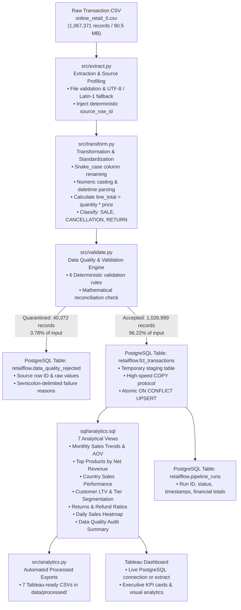
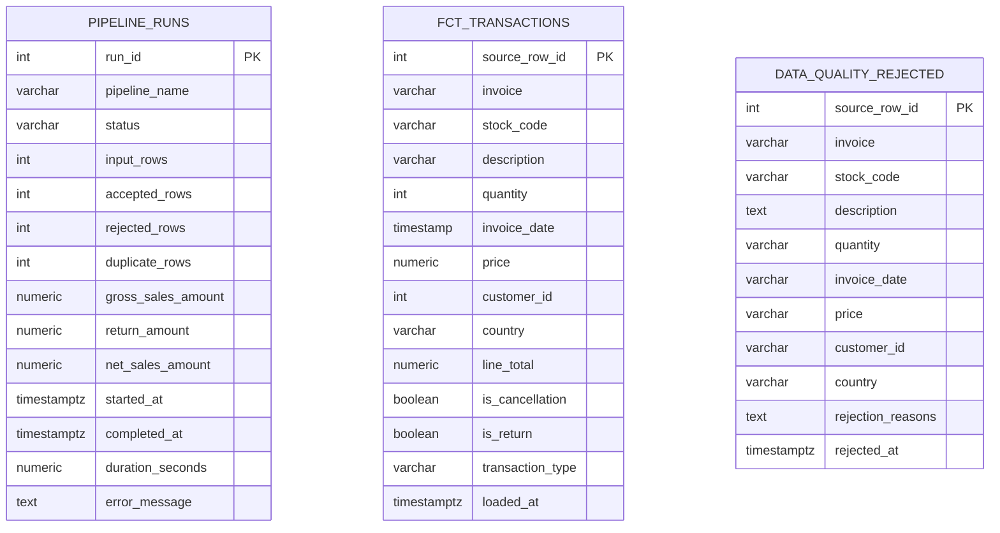

# RetailFlow: Technical Architecture, Data Quality & Analytics Documentation
**Retail ETL, Data Quality Assurance, and Business Intelligence Pipeline**

---

## 1. Executive Summary & Project Purpose

**RetailFlow** is an end-to-end, enterprise-grade data engineering pipeline designed to ingest, cleanse, validate, load, and analyze high-volume retail transaction data. Built using Python, Pandas, PostgreSQL 14, SQLAlchemy, Psycopg 3, and Tableau, the pipeline processes over **1.06 million transaction records** in under **47 seconds**.

### Why RetailFlow Exists
In retail e-commerce, raw transactional streams are notoriously noisy. They contain:
- Duplicate transactions caused by network retries and distributed sync glitches.
- Missing customer identities due to unauthenticated guest checkouts.
- Product returns and cancellations intermingled with internal stock adjustments (breakage, theft, damages, and bad debt write-offs).
- Malformed timestamps and floating-point pricing anomalies.

Directly connecting Business Intelligence (BI) dashboards or machine learning models to raw transaction data leads to distorted KPIs, inflated revenue figures, and compromised executive decisions. 

**RetailFlow solves this** by acting as a deterministic ingestion and validation barrier. It enforces strict data quality contracts, separates commercial cancellations from inventory shrinkage, guarantees line-level source provenance via deterministic tracking IDs, and loads data idempotently into PostgreSQL with mathematical reconciliation guarantees.

---

## 2. Technology Stack & Architectural Decisions

| Layer | Technology | Version | Architectural Role | Why It Was Chosen |
| :--- | :--- | :--- | :--- | :--- |
| **Language** | Python | 3.15.2 (ARM64) | Core application programming language | High-performance ecosystem for data engineering, robust typing, native async and streaming capabilities. |
| **Processing Engine** | Pandas & NumPy | pandas 3.1.0, numpy 2.5.4 | In-memory data transformation & vectorization | Enables vectorized operations on 1M+ rows in under 3 seconds without distributed cluster overhead. |
| **Database** | PostgreSQL | 14.21 | Relational Data Warehouse / Data Mart | Native support for advanced SQL analytics, window functions, table constraints, and the binary `COPY` protocol. |
| **Database Driver** | Psycopg 3 | 3.3.6 (Binary) | Native PostgreSQL adapter | Provides high-throughput streaming via `cursor.copy()`, parameter binding, connection pooling, and transaction control. |
| **ORM / Query Layer**| SQLAlchemy | 2.1.6 | Database abstraction & connection pooling | Standardized engine management, pool pre-pinging, and schema management compatibility. |
| **Configuration** | python-dotenv | 1.2.4 | Twelve-Factor App configuration | Decouples environment variables and database credentials from application source code. |
| **Logging** | Python Logging | Standard Library | Dual-destination structured logging | Concurrent console streaming and daily rotated file persistence for operational auditing. |
| **Automated Testing**| pytest | 9.1.1 | Unit, validation, and integration tests | Test execution with synthetic fixtures, assertions, and custom markers. |
| **Business Intelligence**| Tableau | Desktop / Public | Executive dashboards & visual analytics | Visualizations (dual-axis revenue trends, choropleth maps, cohort segmentation). |
| **Version Control** | Git | 2.x | Distributed source control | Branching strategy and exclusion of secrets (`.env`) and raw data. |

---

## 3. High-Level Architecture & Data Flow



---

## 4. Source Dataset Deep Dive

- **Dataset Source:** Online Retail II UCI Machine Learning Repository (Kaggle: `mashlyn/online-retail-ii-uci`).
- **File Name:** `online_retail_II.csv`
- **Volume:** 1,067,371 rows, 8 columns, 90.46 MB on disk.
- **Date Range:** December 1, 2009 07:45:00 to December 9, 2011 12:50:00 (2 full fiscal years).
- **Domain:** UK-based registered non-store online retailer specializing in unique all-occasion giftware.

### Raw Data Quirks & Business Realities
1. **Invoice Formatting:**
   - 6-digit integers (e.g. `489434`) denote standard commercial sales.
   - Invoices beginning with `C` (e.g. `C489435`) denote customer cancellations.
   - Invoices beginning with `A` (e.g. `A506401`) denote accounting adjustments.
2. **Stock Codes:**
   - Standard products have 5-digit numeric codes (e.g. `85048`) or alphanumeric codes (e.g. `79323P`).
   - Non-product entries use letter codes: `POST` (Postage), `D` (Discount), `M` (Manual), `BANK CHARGES`, and `B` (Adjust bad debt).
3. **Missing Customer IDs (Guest Purchases):**
   - 243,007 rows (22.77%) in the raw file have no `Customer ID`.
   - **Business Treatment:** These are unauthenticated guest checkouts. Discarding them would artificially deflate revenue by over $4 million. RetailFlow preserves them in the fact table with `customer_id = NULL`, including them in gross/net revenue while isolating them from customer cohort retention metrics.
4. **Negative Quantities vs. Negative Prices:**
   - **Negative Quantity with Positive Price (`Quantity < 0`, `Price > 0`):** Legitimate customer returns or cancellations.
   - **Negative Quantity with Zero Price (`Quantity < 0`, `Price = 0.0`):** 3,457 rows representing internal warehouse adjustments (`damages`, `lost`, `short`, `check`).
   - **Negative Price (`Price < 0`):** Exactly 5 rows representing bad debt adjustments (`Adjust bad debt` for StockCode `B`).
   - **Zero Price (`Price == 0.0`):** 6,202 rows of inventory write-offs or free samples without sales revenue.

---

## 5. Module-by-Module Technical Walkthrough

### 5.1 Configuration Management (`src/config.py`)
- Employs an immutable `@dataclass(frozen=True)` pattern (`Settings`).
- Reads credentials from `.env` via `python-dotenv`.
- Overrides `__repr__` to mask database passwords (`***MASKED***`) in console outputs and logs.
- Configures dual logging handlers: `StreamHandler` for interactive CLI and `FileHandler` for timestamped daily audit logs (`logs/retailflow_YYYYMMDD.log`).

### 5.2 Source Extraction (`src/extract.py`)
- Validates file existence, file type, and permissions before opening.
- Enforces explicit string data typing for identifiers (`Invoice`, `StockCode`, `Customer ID`) to prevent truncation of leading zeros or erroneous scientific notation.
- Implements an automated encoding fallback mechanism: attempts standard `UTF-8` first, catching `UnicodeDecodeError` and falling back to `latin1` (`ISO-8859-1`).
- **Injects Deterministic Lineage:** Adds `source_row_id` (1-indexed CSV line number: 1 to 1,067,371) to ensure full traceability from raw disk to database row.

### 5.3 Data Transformation (`src/transform.py`)
- **Column Standardization:** Maps raw headers (`Customer ID`, `InvoiceDate`) to lowercase snake_case standard (`customer_id`, `invoice_date`).
- **Text Normalization:** Strips leading/trailing whitespace, converts `stock_code` to uppercase, and title-cases country names with acronym preservation (`USA`, `EIRE`, `RSA`).
- **Customer ID Parsing:** Cleans floating-point artifacts (`13085.0` -> `13085`) and casts to nullable pandas integer `Int64`.
- **Financial Metric Derivation:**
  $$\text{line\_total} = \text{round}(\text{quantity} \times \text{price}, 2)$$
- **Transaction Classification:**
  - `SALE`: Standard commercial transaction (`quantity > 0` and invoice does not begin with `C`).
  - `CANCELLATION`: Order cancelled (`invoice` begins with `C`).
  - `RETURN`: Goods returned (`quantity < 0`).

### 5.4 Data Quality Validation Engine (`src/validate.py`)
Evaluates candidate records against 6 auditable quality rules:
1. `RULE_EXACT_DUPLICATE`: Identical repeated records across business attributes.
2. `RULE_ZERO_PRICE`: Non-commercial inventory adjustments where unit price is zero.
3. `RULE_NEGATIVE_PRICE`: Accounting adjustments and bad debt entries (`price < 0`).
4. `RULE_MISSING_KEY`: Missing invoice or stock code.
5. `RULE_INVALID_DATE`: Timestamps that fail ISO datetime parsing.
6. `RULE_INVALID_NUMERIC`: Non-numeric quantities or prices.

#### Quarantine & Mathematical Reconciliation
- Records failing one or more rules are flagged with concatenated semicolon-delimited reasons (e.g. `RULE_EXACT_DUPLICATE;RULE_ZERO_PRICE`).
- The dataset is partitioned into `accepted_df` and `rejected_df`.
- The engine asserts the **Reconciliation Contract**:
  $$\text{Total Input Rows} \equiv \text{Accepted Rows} + \text{Quarantined Rows}$$
  $$1,067,371 = 1,026,999 + 40,372 \quad (\text{Reconciliation Verified: True})$$

### 5.5 High-Throughput Idempotent Loading (`src/load.py`)
- **DDL Execution:** Reads and executes `sql/schema.sql` to initialize schemas, tables, and B-tree indexes.
- **PostgreSQL COPY Streaming:** Rather than performing slow iterative `INSERT` statements or standard ORM row mapping, `src/load.py` streams clean records using `psycopg3`'s native binary/text `cursor.copy()` protocol.
- **Idempotent Staging Pattern:**
  1. Creates a temporary session-scoped table `tmp_fct_staging` mirroring `retailflow.fct_transactions`.
  2. Copies records into staging in memory.
  3. Executes an atomic `INSERT INTO ... SELECT ... ON CONFLICT (source_row_id) DO UPDATE SET ...`.
  4. Drops the staging table.
- **Rerun Safety:** Re-running the pipeline on identical data leaves table counts unchanged at exactly `1,026,999` without primary key conflicts or duplicate records.
- **Audit Logging:** Inserts execution metrics into `retailflow.pipeline_runs` within the same transaction.

### 5.6 Analytical Views & CSV Export (`src/analytics.py`)
- Connects to PostgreSQL using an SQLAlchemy connection pool.
- Compiles 7 analytical views.
- Automatically exports clean query results as CSV files into `data/processed/` for direct consumption by Tableau Public, Power BI, or Excel.
- Prints an executive console summary with net revenue, AOV, cancellation rates, and customer totals.

### 5.7 Master Pipeline Orchestrator (`src/pipeline.py` & `main.py`)
- Coordinates the execution lifecycle: `Extract` -> `Transform` -> `Validate` -> `Load` -> `Analytics`.
- Captures stage-level timings, monitors memory safety, logs events, and provides formatted terminal summaries.

---

## 6. Database Schema & Data Dictionary

### Target Database: `retailflow_db` | Schema: `retailflow`



### Table Definitions

#### 1. `retailflow.fct_transactions` (Clean Transactions Fact Table)
| Column | Type | Constraints | Description |
| :--- | :--- | :--- | :--- |
| `source_row_id` | `INT` | `PRIMARY KEY` | 1-indexed deterministic CSV line number. Ensures 100% provenance and rerun idempotency. |
| `invoice` | `VARCHAR(30)` | `NOT NULL` | 6-digit transaction ID (prefixed with `C` if cancellation). |
| `stock_code` | `VARCHAR(30)` | `NOT NULL` | Product SKU or service identifier. |
| `description` | `VARCHAR(255)` | `NULLABLE` | Product commercial description. |
| `quantity` | `INT` | `NOT NULL` | Units purchased (positive) or returned (negative). |
| `invoice_date` | `TIMESTAMP` | `NOT NULL` | Transaction timestamp. |
| `price` | `NUMERIC(10,2)`| `NOT NULL` | Unit selling price in GBP (£). |
| `customer_id` | `INT` | `NULLABLE` | Customer account identifier (NULL for guest checkouts). |
| `country` | `VARCHAR(100)`| `NOT NULL` | Customer country of residence. |
| `line_total` | `NUMERIC(12,2)`| `NOT NULL` | Derived commercial revenue: `quantity * price`. |
| `is_cancellation`| `BOOLEAN` | `DEFAULT FALSE`| Flag indicating cancellation order (`invoice` begins with `C`). |
| `is_return` | `BOOLEAN` | `DEFAULT FALSE`| Flag indicating returned goods (`quantity < 0`). |
| `transaction_type`| `VARCHAR(20)`| `NOT NULL` | Categorical label: `SALE`, `CANCELLATION`, or `RETURN`. |
| `loaded_at` | `TIMESTAMPTZ` | `DEFAULT NOW()`| Timestamp when row was inserted or updated. |

*Indexes:*
- `idx_fct_tx_invoice` on `invoice`
- `idx_fct_tx_stock_code` on `stock_code`
- `idx_fct_tx_invoice_date` on `invoice_date`
- `idx_fct_tx_customer_id` on `customer_id`
- `idx_fct_tx_country` on `country`
- `idx_fct_tx_type` on `transaction_type`
- `idx_fct_tx_date_type` on `(invoice_date, transaction_type)`

#### 2. `retailflow.data_quality_rejected` (Quarantined Records Table)
| Column | Type | Constraints | Description |
| :--- | :--- | :--- | :--- |
| `source_row_id` | `INT` | `PRIMARY KEY` | Source row number from original raw CSV. |
| `invoice` ... `country` | `VARCHAR` | `NULLABLE` | Raw, unparsed string values of candidate transaction fields. |
| `rejection_reasons` | `TEXT` | `NOT NULL` | Semicolon-delimited failure reasons (`RULE_EXACT_DUPLICATE;RULE_ZERO_PRICE`). |
| `rejected_at` | `TIMESTAMPTZ` | `DEFAULT NOW()`| Timestamp of quarantine. |

#### 3. `retailflow.pipeline_runs` (Audit & Run History)
Tracks execution metadata including run status (`SUCCESS` / `FAILED`), input row counts, accepted and rejected quantities, financial sums, durations, and system error messages.

---

## 7. Analytical SQL Views & Metrics

RetailFlow creates 7 analytical views in `sql/analytics.sql`:

### 1. `retailflow.vw_monthly_sales_trends`
- **Objective:** Tracks month-over-month executive sales metrics, order counts, return volumes, and Average Order Value (AOV).
- **Core Formula:**
  $$\text{Net Revenue} = \text{Gross Sales} - \text{Refund Amount}$$
  $$\text{AOV} = \frac{\text{Gross Revenue}}{\text{Sales Orders}}$$
  $$\text{Cancellation Rate (\%)} = \frac{\text{Cancellation Orders}}{\text{Total Invoices}} \times 100$$

### 2. `retailflow.vw_top_products_by_revenue`
- **Objective:** Ranks 4,760 catalog items using window function `DENSE_RANK() OVER (ORDER BY net_revenue DESC)`.
- **Metrics:** Total orders, gross units sold, units returned, net revenue, and return rate percentage.

### 3. `retailflow.vw_country_sales_performance`
- **Objective:** Analyzes geographical market share across 43 customer countries.
- **Metrics:** Order count, customer count, units sold, net revenue, AOV, and `% of Global Revenue` calculated via window aggregation:
  $$\text{Pct of Global Revenue} = \frac{\text{SUM}(\text{line\_total})}{\text{SUM}(\text{SUM}(\text{line\_total})) \text{ OVER}()} \times 100$$

### 4. `retailflow.vw_customer_order_metrics`
- **Objective:** Evaluates customer lifetime value (LTV), purchasing frequency, and customer tenure in days (`latest_purchase_date - first_purchase_date`).
- **Segmentation Tiers:**
  - `Platinum`: $\ge \$5,000$ net spend
  - `Gold`: $\ge \$2,000$ net spend
  - `Silver`: $\ge \$500$ net spend
  - `Bronze`: $< \$500$ net spend

### 5. `retailflow.vw_returns_and_cancellations`
- **Objective:** Monitors refund leakage by calculating the refund-to-gross sales ratio on a monthly basis.

### 6. `retailflow.vw_daily_sales_summary`
- **Objective:** Granular daily time-series analysis with day-of-week breakdown (`EXTRACT(DOW FROM invoice_date)`), useful for identifying peak shopping days and operational staffing needs.

### 7. `retailflow.vw_data_quality_summary`
- **Objective:** Continuous quality monitoring aggregating quarantined records by specific failure rule.

---

## 8. Tableau Dashboard Specification

### Connection Methods
1. **Live PostgreSQL Connection (Tableau Desktop):**
   - Host: `localhost` | Port: `5432` | Database: `retailflow_db` | Schema: `retailflow`
2. **Pre-Aggregated Extracts (Tableau Public / Offline):**
   - Connect directly to the 7 generated files in `data/processed/`.

### Dashboard Layout Wireframe (1366 x 768)

```text
+----------------------------------------------------------------------------------------------------+
|                                    RETAILFLOW EXECUTIVE DASHBOARD                                  |
|   Filters: [Date Range: 2009-12 to 2011-12]  |  [Country: All]  |  [Customer Tier: All]           |
+----------------------------------------------------------------------------------------------------+
|  [Net Realized Revenue]   [Gross Sales]    [Return Amount]    [Total Sales Orders]   [AOV]         |
|        $19.01M               $20.48M           $1.46M                 40,077        $510.92        |
+----------------------------------------------------+-----------------------------------------------+
|  CHART 1: Monthly Net vs Gross Revenue Trend       |  CHART 2: Top 10 Products by Net Revenue      |
|  (Dual-Axis Area + Line Chart over 24 Months)     |  (Horizontal Bar Chart with Return Overlay)   |
+----------------------------------------------------+-----------------------------------------------+
|  CHART 3: Global Sales by Country                  |  CHART 4: Data Quality & Pipeline Health      |
|  (Choropleth Map / Tree Map of Geographic Sales)  |  (Donut Chart: 96.22% Accepted vs 3.78% Rej.) |
+----------------------------------------------------+-----------------------------------------------+
```

Full worksheet configuration instructions and KPI mappings are documented in [`dashboard/README.md`](dashboard/README.md).

---

## 9. Automated Testing & Verification Suite

RetailFlow utilizes `pytest` with synthetic in-memory fixtures. Unit tests execute in under 1 second without modifying database state.

### Test Coverage Summary (16 Tests)

| Test File | Test Name | Purpose & Assertion |
| :--- | :--- | :--- |
| `test_transform.py` | `test_standardize_columns` | Verifies column normalization to snake_case. |
| `test_transform.py` | `test_clean_text_fields` | Verifies whitespace stripping and acronym preservation. |
| `test_transform.py` | `test_parse_customer_id` | Verifies `.0` removal and integer casting. |
| `test_transform.py` | `test_convert_datatypes` | Verifies numeric and datetime type conversions. |
| `test_transform.py` | `test_calculate_derived_fields` | Tests `line_total` math and transaction classification (`SALE`/`CANCELLATION`/`RETURN`). |
| `test_transform.py` | `test_end_to_end_transform` | Validates full transformation flow on synthetic batch. |
| `test_validate.py` | `test_validation_partitions_and_reconciles` | Proves `accepted + rejected == input` reconciliation. |
| `test_validate.py` | `test_duplicate_detection` | Tests isolation of exact duplicates with `RULE_EXACT_DUPLICATE`. |
| `test_validate.py` | `test_price_validation` | Validates rejection of negative and zero prices. |
| `test_validate.py` | `test_missing_key_detection` | Tests rejection when invoice or SKU is missing. |
| `test_validate.py` | `test_invalid_date_and_numeric_detection`| Tests handling of corrupt dates and NaN quantities. |
| `test_validate.py` | `test_guest_checkout_retained` | Asserts guest checkouts (`customer_id=NULL`) are retained. |
| `test_validate.py` | `test_accepted_cancellations_retained` | Asserts valid commercial cancellations are retained. |
| `test_pipeline.py` | `test_extract_nonexistent_file` | Validates `ExtractionError` when CSV path is missing. |
| `test_pipeline.py` | `test_synthetic_pipeline_flow` | Executes full extract-transform-validate on temporary file. |
| `test_pipeline.py` | `test_database_idempotency` | Loads batch twice and verifies zero duplicate inserts. |

---

## 10. How to Run, Test, and Verify

### 1. Run the Pipeline
```bash
./.venv/bin/python main.py
# or
./.venv/bin/python -m src.pipeline
```

### 2. Execute Automated Tests
```bash
./.venv/bin/pytest -v
```


### 3. Verify Database Objects in PostgreSQL
```bash
./.venv/bin/python -c "
import psycopg, os, dotenv
dotenv.load_dotenv('.env')
conn = psycopg.connect(f'dbname={os.getenv(\"DB_NAME\")} user={os.getenv(\"DB_USER\")} password={os.getenv(\"DB_PASSWORD\")} host={os.getenv(\"DB_HOST\")}')
with conn.cursor() as cur:
    cur.execute('SELECT COUNT(*), ROUND(SUM(line_total), 2) FROM retailflow.fct_transactions;')
    cnt, rev = cur.fetchone()
    print(f'Clean Transactions in DB: {cnt:,}')
    print(f'Total Net Revenue in DB:   \${rev:,.2f}')
    cur.execute('SELECT COUNT(*) FROM retailflow.data_quality_rejected;')
    print(f'Quarantined Records in DB: {cur.fetchone()[0]:,}')
"
```

### 4. Inspect Execution Logs
```bash
tail -n 30 logs/retailflow_$(date +%Y%m%d).log
```

---

## 11. Production Roadmap & Architectural Enhancements

For enterprise-scale production deployments (e.g. 100M+ transactions/day):
1. **Change Data Capture (CDC):** Replace batch CSV ingestion with Debezium / Apache Kafka streaming directly from transactional OLTP databases.
2. **Data Transformation with dbt:** Migrate SQL view logic into modular, testable dbt models (`stg_`, `int_`, `fct_`) with automated documentation.
3. **Workflow Orchestration:** Schedule daily runs, handle retry backoffs, and trigger Slack/PagerDuty alert webhooks using Apache Airflow or Prefect.
4. **Cloud Migration:** Transition PostgreSQL storage to Snowflake, Google BigQuery, or Amazon Redshift using partitioned Parquet lakehouse storage on S3 or GCS.
