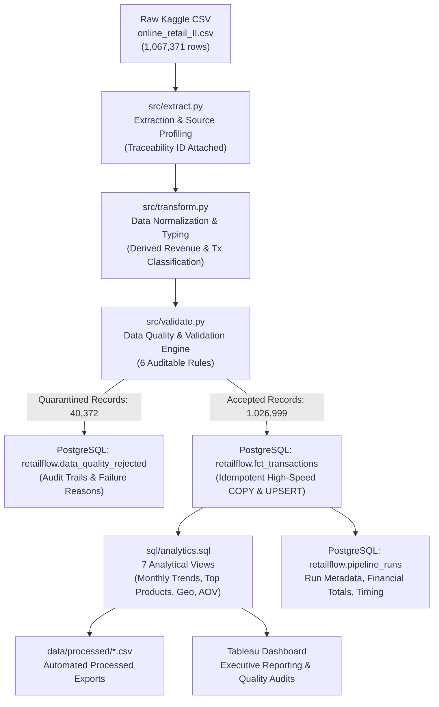

# RetailFlow — Retail ETL, Data Quality & Sales Analytics Pipeline

[](https://www.python.org/)
[](https://www.postgresql.org/)
[](https://pandas.pydata.org/)
[](https://www.sqlalchemy.org/)
[](https://docs.pytest.org/)
[](https://www.tableau.com/)

RetailFlow is an end-to-end, production-grade retail data engineering pipeline. It ingests over 1 million rows of raw transactional data, performs rigorous data quality profiling and quarantine partitioning, loads clean records idempotently into PostgreSQL 14, exposes business-critical analytical SQL views, and connects to Tableau for executive sales and data quality reporting.

---

## Architecture Overview



---

## Business Problem & Context

Retail enterprises generate millions of e-commerce transactions that suffer from:
1. **Duplicate Records:** Network retries, system re-transmissions, and batch replication errors inflating sales figures.
2. **Missing Customer Identifiers:** Guest checkouts and unauthenticated transactions that must be preserved for financial revenue reporting while isolated during customer retention calculations.
3. **Cancellations vs. Inventory Shrinkage:** Conflation of valid commercial cancellations (invoices starting with `C`) with internal warehouse adjustments (zero-price damages, stock takes, and bad debt write-offs).
4. **Data Drift & Silent Corruption:** Unvalidated data leaking directly into executive dashboards, producing faulty KPIs and revenue overstatements.

**RetailFlow resolves this** by enforcing an auditable data contract: 100% of input records are deterministically classified, clean transactions are loaded into PostgreSQL using transactional idempotent upserts, and flawed records are quarantined into an audit table with granular rejection codes.

---

## Key Verified Results & Execution Metrics

The pipeline was executed and benchmarked against the full dataset on local PostgreSQL 14:

| Pipeline Stage | Real Verified Metric |
| :--- | :--- |
| **Input Dataset Rows** | **1,067,371 rows** (90.46 MB, 2-year UCI Online Retail II) |
| **Pipeline Extraction Runtime** | **0.49 seconds** (UTF-8 auto-encoding with fallback) |
| **Transformation Runtime** | **2.65 seconds** (Vectorized Pandas typing and derived metrics) |
| **Validation Runtime** | **0.97 seconds** (Deterministic multi-rule evaluation) |
| **Database Load Runtime** | **30.41 seconds** (High-throughput PostgreSQL `COPY` + UPSERT) |
| **Analytical Views & Export** | **12.20 seconds** (7 SQL views compiled & exported to CSV) |
| **Total End-to-End Runtime** | **46.71 seconds** |
| **Accepted Fact Records** | **1,026,999 records** (**96.22%** of inputs) |
| **Quarantined Records** | **40,372 records** (**3.78%** of inputs) |
| **Exact Duplicates Quarantined** | **34,335 records** |
| **Zero-Price Adjustments Quarantined** | **6,220 records** (lost, damaged, inventory checks) |
| **Negative Price Adjustments Quarantined**| **5 records** (accounting bad debt write-offs) |
| **Reconciliation Status** | **100% Verified Match:** `1,026,999 + 40,372 == 1,067,371` |
| **Gross Commercial Sales** | **$20,476,260.43** |
| **Returns & Cancellations Refunded** | **$1,462,797.75** |
| **Net Realized Revenue** | **$19,014,209.82** |
| **Completed Sales Orders** | **40,077 orders** |
| **Average Order Value (AOV)** | **$510.92** |
| **Unique Customer Accounts** | **5,939 accounts** |
| **Unique Catalog Products** | **4,760 products** |
| **Automated Test Suite** | **16 / 16 unit and integration tests passed (100%)** |

---

## Technology Stack

| Layer | Component | Version / Library |
| :--- | :--- | :--- |
| **Language** | Python | 3.15.2 (ARM64 Apple Silicon) |
| **Data Manipulation** | Pandas & NumPy | pandas 3.1.0, numpy 2.5.4 |
| **Database** | PostgreSQL | 14.21 |
| **Database Driver** | Psycopg 3 & SQLAlchemy | psycopg 3.3.6 (binary), SQLAlchemy 2.1.6 |
| **Environment & Config** | python-dotenv | 1.2.4 |
| **Testing** | pytest | 9.1.1 |
| **BI & Analytics** | PostgreSQL SQL Views & Tableau | Tableau Desktop / Public Ready |
| **Logging** | Python standard logging | Console & file rotated daily logs |

---

## Data Quality Rules & Reconciliation Framework

Each incoming row is evaluated against 6 deterministic validation rules. Rather than discarding invalid rows, RetailFlow quarantines them into `retailflow.data_quality_rejected` with full source traceability (`source_row_id`) and explicit failure reasons.

```
Total Source Rows: 1,067,371
├── Accepted Fact Records (1,026,999 rows / 96.22%)
│   ├── Commercial Sales: 1,007,895 rows (Gross revenue: $20.48M)
│   ├── Commercial Cancellations: 19,104 rows (Invoices starting with 'C')
│   └── Valid Returns: (Refund adjustments: $1.46M)
└── Quarantined Records (40,372 rows / 3.78%)
    ├── RULE_EXACT_DUPLICATE: 34,335 rows (Identical repeated transmissions)
    ├── RULE_ZERO_PRICE: 6,220 rows (Internal damages, lost items, stock counts)
    ├── RULE_NEGATIVE_PRICE: 5 rows (Accounting bad debt adjustments)
    └── RULE_MISSING_KEY / INVALID_DATE: 0 rows in raw source
```

### Treatment of Specialized Records

1. **Cancellations (`is_cancellation = TRUE`):**
   - Invoices beginning with `C` represent customer-initiated cancellations and refunds.
   - Preserved in `retailflow.fct_transactions` with negative `line_total` (`quantity * price`).
   - Allows calculating Gross Commercial Sales, Total Returns, and Net Revenue accurately.
2. **Returns (`is_return = TRUE`):**
   - Transactions with negative quantity and positive price.
   - Tracked in `retailflow.vw_returns_and_cancellations` to compute product return rates.
3. **Guest / Unregistered Checkouts (`customer_id IS NULL`):**
   - 229,202 accepted rows (22.32%) represent guest buyers without account IDs.
   - **Retained in fact table** because cash was realized.
   - Excluded from customer retention and lifetime value views (`vw_customer_order_metrics`), but fully included in executive revenue totals.
4. **Administrative & Inventory Adjustments (`price <= 0`):**
   - Rows with descriptions like `damages`, `lost`, `check`, `?`, or stock write-offs (`Price = 0.0` or `Price < 0`).
   - Quarantined into `retailflow.data_quality_rejected`.

---

## Data Schema & Data Dictionary

### Target Database: `retailflow_db` | Schema: `retailflow`

#### `retailflow.fct_transactions`
| Column Name | Type | Constraints | Description & Treatment |
| :--- | :--- | :--- | :--- |
| `source_row_id` | `INT` | `PRIMARY KEY` | 1-indexed deterministic row number from raw CSV. Guarantees idempotency and 100% audit traceability. |
| `invoice` | `VARCHAR(30)` | `NOT NULL` | 6-digit transaction identifier. Prefixed with `C` if cancelled. |
| `stock_code` | `VARCHAR(30)` | `NOT NULL` | Product SKU or service identifier. Standardized to uppercase. |
| `description` | `VARCHAR(255)` | `NULLABLE` | Product title/name. Trimmed of extraneous whitespace. |
| `quantity` | `INT` | `NOT NULL` | Units purchased (positive) or refunded (negative). |
| `invoice_date` | `TIMESTAMP` | `NOT NULL` | Timestamp of sale (2009-12-01 to 2011-12-09). |
| `price` | `NUMERIC(10,2)`| `NOT NULL` | Unit commercial selling price in GBP (£). |
| `customer_id` | `INT` | `NULLABLE` | 5-digit customer identifier. Null for guest purchases. |
| `country` | `VARCHAR(100)`| `NOT NULL` | Customer country of residence. Normalized to title case / official acronyms (e.g. `USA`, `EIRE`). |
| `line_total` | `NUMERIC(12,2)`| `NOT NULL` | Calculated field: `quantity * price` (rounded to 2 decimal places). |
| `is_cancellation`| `BOOLEAN` | `DEFAULT FALSE`| Flag indicating cancellation order (`invoice` begins with `C`). |
| `is_return` | `BOOLEAN` | `DEFAULT FALSE`| Flag indicating returned units (`quantity < 0`). |
| `transaction_type`| `VARCHAR(20)`| `NOT NULL` | Categorical classification: `SALE`, `CANCELLATION`, `RETURN`. |
| `loaded_at` | `TIMESTAMPTZ` | `DEFAULT NOW()`| Timestamp when row was inserted or updated in PostgreSQL. |

#### `retailflow.data_quality_rejected`
| Column Name | Type | Description |
| :--- | :--- | :--- |
| `source_row_id` | `INT PRIMARY KEY` | Original CSV row number of the quarantined record. |
| `invoice` ... `country` | `VARCHAR` | Raw unmodified string values of candidate transaction fields. |
| `rejection_reasons` | `TEXT` | Semicolon-delimited failure codes (e.g. `RULE_EXACT_DUPLICATE`, `RULE_ZERO_PRICE`). |
| `rejected_at` | `TIMESTAMPTZ` | Ingestion timestamp when record was quarantined. |

#### `retailflow.pipeline_runs`
| Column Name | Type | Description |
| :--- | :--- | :--- |
| `run_id` | `SERIAL PRIMARY KEY` | Auto-incrementing pipeline run execution ID. |
| `pipeline_name` | `VARCHAR(50)` | Name of ETL job (`retailflow_etl`). |
| `status` | `VARCHAR(20)` | Final run status (`SUCCESS` or `FAILED`). |
| `input_rows` / `accepted_rows` / `rejected_rows` | `INT` | Auditable row counts. |
| `gross_sales_amount` / `net_sales_amount` | `NUMERIC(14,2)` | Financial totals verified at load time. |
| `started_at` / `completed_at` / `duration_seconds` | `TIMESTAMPTZ` / `NUMERIC` | Execution timings. |

---

## Analytical SQL Views

RetailFlow implements 7 SQL views in `sql/analytics.sql`:

1. **`retailflow.vw_monthly_sales_trends`:**
   Monthly Net Revenue, Gross Sales, Return Amount, Sales Order count, Cancellation count, and Average Order Value (AOV).
2. **`retailflow.vw_top_products_by_revenue`:**
   Ranks 4,760 products by Net Revenue using `DENSE_RANK() OVER (ORDER BY net_revenue DESC)`, tracking total units sold, units returned, and return percentage.
3. **`retailflow.vw_country_sales_performance`:**
   Aggregates sales across 43 countries, calculating regional net revenue, total orders, active customer counts, and `% of Global Revenue`.
4. **`retailflow.vw_customer_order_metrics`:**
   Analyzes customer lifetime value (LTV), purchase frequency, tenure in days, and segments customers into `Platinum` (>= $5,000), `Gold` (>= $2,000), `Silver` (>= $500), and `Bronze`.
5. **`retailflow.vw_returns_and_cancellations`:**
   Monitors monthly refund volume, items returned, and refund-to-gross revenue ratios.
6. **`retailflow.vw_daily_sales_summary`:**
   Daily time-series metrics with day-of-week breakdown for demand forecasting and staffing analysis.
7. **`retailflow.vw_data_quality_summary`:**
   Summary of quarantined rejection reasons and percentage breakdown for data quality monitoring.

---

## Tableau Dashboard Design

The dashboard specification is detailed in [`dashboard/README.md`](dashboard/README.md).

```
+----------------------------------------------------------------------------------------------------+
|                                    RETAILFLOW EXECUTIVE DASHBOARD                                  |
|   Filters: [Date Range: 2009-12 to 2011-12]  |  [Country: All]  |  [Customer Tier: All]           |
+----------------------------------------------------------------------------------------------------+
|  [Net Realized Revenue]   [Gross Sales]    [Return Amount]    [Total Sales Orders]   [AOV]         |
|        $19.01M               $20.48M           $1.46M                 40,077        $510.92        |
+----------------------------------------------------+-----------------------------------------------+
|  CHART 1: Monthly Net vs Gross Revenue Trend       |  CHART 2: Top 10 Products by Net Revenue      |
|  (Dual-Axis Area + Line Chart over 24 Months)     |  (Horizontal Bar Chart with Return Overlay)   |
+----------------------------------------------------+-----------------------------------------------+
|  CHART 3: Global Sales by Country                  |  CHART 4: Data Quality & Pipeline Health      |
|  (Choropleth Map / Tree Map of Geographic Sales)  |  (Donut Chart: 96.22% Accepted vs 3.78% Rej.) |
+----------------------------------------------------+-----------------------------------------------+
```

### Connection Guide
- **Tableau Desktop:** Connect directly to PostgreSQL `retailflow_db` on `localhost:5432`, schema `retailflow`.
- **Tableau Public / Offline:** Connect directly to the pre-aggregated CSV extracts located in `data/processed/`.


---

## How to Set Up and Run

### 1. Environment Requirements
- Python 3.10+ (tested on Python 3.15.2 ARM64).
- PostgreSQL 14+ running locally on port 5432.
- Virtual environment at `~/RetailFlow/.venv`.

### 2. Configuration
Copy `.env.example` to `.env` and set your local PostgreSQL credentials:
```bash
cp .env.example .env
```
Ensure `.env` contains:
```dotenv
DB_HOST=localhost
DB_PORT=5432
DB_NAME=retailflow_db
DB_USER=chehak
DB_PASSWORD=your_actual_password
DB_SCHEMA=retailflow
LOG_LEVEL=INFO
DATA_RAW_PATH=data/raw/online_retail_II.csv
DATA_PROCESSED_PATH=data/processed
```

### 3. Run the Automated Test Suite
```bash
./.venv/bin/pytest -v
```
All 16 unit and integration tests run in under 1 second.

### 4. Execute the Full ETL Pipeline
```bash
python -m src.pipeline
# or
python main.py
```

### 5. Idempotent Rerun Safety
RetailFlow uses temporary staging tables and atomic `ON CONFLICT (source_row_id) DO UPDATE` operations. You can rerun `python -m src.pipeline` repeatedly:
- Table row counts remain exactly `1,026,999` for fact records and `40,372` for rejected records.
- Zero duplicate records are created.
- Full database transaction rollbacks protect against partial loading failures.

---

## Repository Structure

```text
RetailFlow/
├── data/
│   ├── raw/
│   │   └── online_retail_II.csv       # Raw source dataset (excluded from git)
│   └── processed/                     # Tableau-ready pre-aggregated CSVs
│       ├── monthly_sales_trends.csv
│       ├── top_products_by_revenue.csv
│       ├── country_sales_performance.csv
│       ├── customer_order_metrics.csv
│       ├── returns_and_cancellations.csv
│       ├── daily_sales_summary.csv
│       └── data_quality_summary.csv
├── src/
│   ├── __init__.py
│   ├── config.py                      # Strongly-typed settings and masked secrets
│   ├── extract.py                     # CSV ingestion, encoding fallback, and source row ID
│   ├── transform.py                   # Column normalization, typing, and financial metrics
│   ├── validate.py                    # 6 Data quality rules, reconciliation engine
│   ├── load.py                        # High-speed COPY, staging table, and idempotent UPSERT
│   ├── analytics.py                   # Executive KPI calculations and CSV exporter
│   └── pipeline.py                    # Master orchestrator entry point
├── sql/
│   ├── schema.sql                     # PostgreSQL DDL for schema, tables, and indexes
│   └── analytics.sql                  # 7 Production SQL analytical views
├── tests/
│   ├── __init__.py
│   ├── test_transform.py              # Unit tests for transformations and typing
│   ├── test_validate.py               # Unit tests for DQ rules and reconciliation
│   └── test_pipeline.py               # Integration tests and DB idempotency verification
├── dashboard/
│   ├── README.md                      # Complete Tableau connection and build guide
│   └── screenshots/                   # Directory for Tableau dashboard captures
├── logs/                              # Daily timestamped log files (excluded from git)
├── .env                               # Local secrets (excluded from git)
├── .env.example                       # Committed template configuration
├── .gitignore                         # Comprehensive git exclusions
├── pytest.ini                         # Pytest configuration and custom test markers
├── requirements.txt                   # Verified production dependencies
├── main.py                            # Application entry point
└── README.md                          # Production project documentation
```

---

## Known Limitations & Production Enhancements

1. **Incremental CDC (Change Data Capture):** The current implementation ingests the historical batch file idempotently. For a streaming production system, Debezium or Kafka Connect can capture row-level CDC from the source transactional database.
2. **Cloud Data Warehouse Migration:** For datasets exceeding 100M rows, the transformation logic easily ports to dbt + Snowflake / BigQuery.
3. **Workflow Orchestration:** When scaling to multiple external data sources, Apache Airflow or Prefect can schedule daily pipeline runs and trigger Slack data quality alert webhooks.
